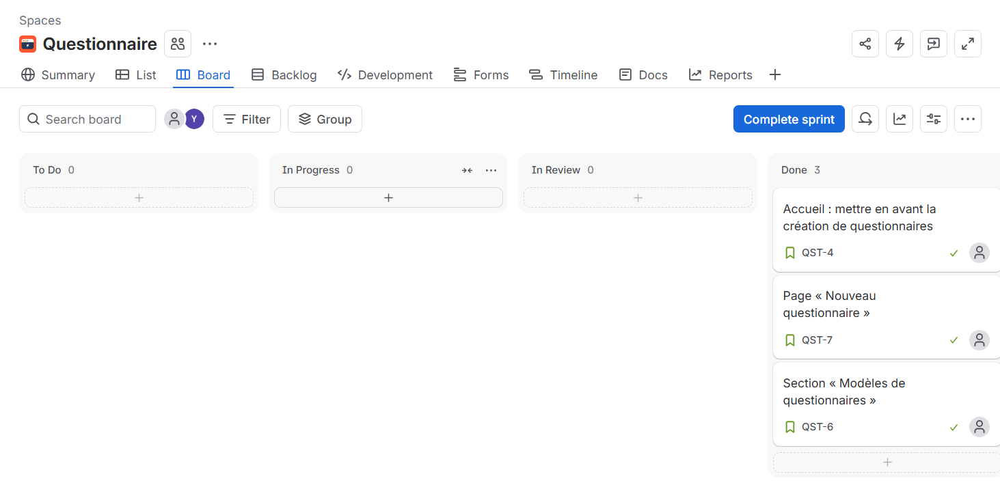

# Livrable TP1

- Membre A : Yassin Ayedi (@Yassin-ayedi)
- Membre B : Prénom Nom (@yessineallani)
- Membre C : Prénom Nom (@hadilezzine)
- Fork : https://github.com/Yassin-ayedi/devops2-tp1
- Site Jira : https://<ton-site>.atlassian.net
- QST-2 (commit/branche) = QST-4 (Jira) : Accueil, réalisée par Yassin
- QST-3 (commit/branche) = QST-7 (Jira) : Page Nouveau questionnaire, réalisée par yessine
- QST-4 (commit/branche) = QST-6 (Jira) : Modèles (bonus), réalisée par hadil
- Site Jira : https://yassiinayadi.atlassian.net
- Liaison Jira ↔ GitHub (bonus) : réalisée (clés Jira différentes des commits, voir correspondance ci-dessus)

